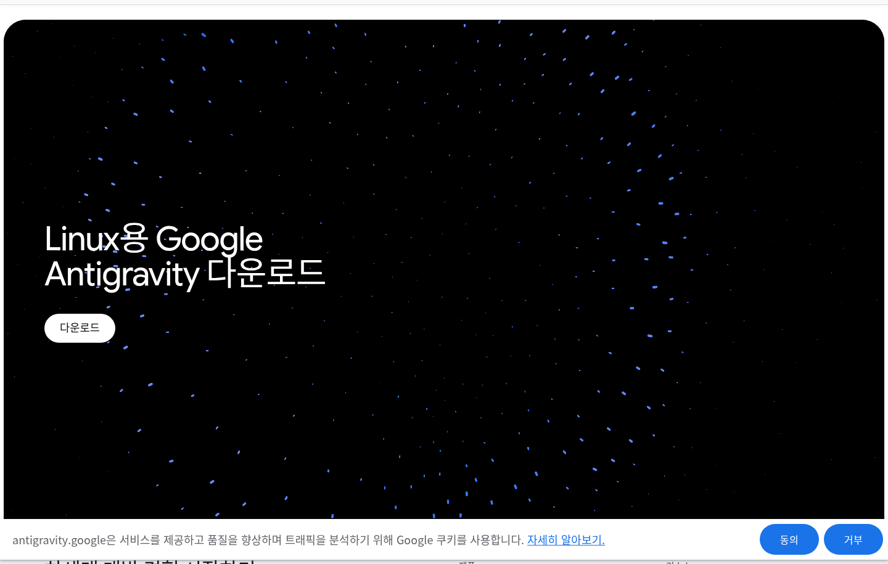

## 좋은 점
사용자 메모: "유들거리는 느낌 살려봐". 어떤 속성인지는 아직 확인 전이고, 아래는 마우스를 옮기며 프레임을 나눠 찍어 보고(0.15·0.3·0.6·1.2초) 해석한 것.
- 마우스 둘레 반지름 250~300px 고리 안의 입자만 커지고 파래짐(짧은 캡슐, 약 2×8px). 고리 밖은 1px 점.
- 고리 중심이 마우스를 바로 따라가지 않음. 마우스를 한 번에 옮기면 0.15초 뒤에도 거의 제자리이고, 1.2초 뒤에도 아직 미끄러지는 중. 늦게, 끈적하게 따라옴.
- 고리가 정원이 아니라 움직이는 쪽으로 늘어나고 일그러진 채 따라옴. 입자는 고리 중심 쪽으로 누워 있고, 고리가 움직이면 같이 돌아감.

## 우리 사이트에 쓰면
홈 히어로 오른쪽 칸의 바람 줄기(`assets/js/modules/wind.js`). 마우스를 늦게, 출렁이며 따라오는 점을 하나 두고 줄기들이 그 점 쪽으로 휘어 감겨 돌게 함.

## 버릴 점
검정 바탕, 화면 전체에 깐 입자 격자, 파랑 한 색, 쿠키 배너.

---

## 자동 수집 (capture.mjs)
<!-- 브라우저가 계산한 값입니다. 손으로 고치지 말고, 다시 뽑으려면 capture.mjs를 다시 실행하세요. -->

```text
화면 폭 1440px · selector 일치 1개

대상  div.astro-lcdefpme  1440×852
  색      color #121317
  배치    display block
부모  main.main.astro-lcdefpme  1440×9911
  배치    display block
자식  1개: section#download-section.download-section-container.download-section-container--mobile-desktop-only 1440×852

글자 스타일 (큰 것부터)
  54px w450 lh 1.04 ls -0.018em Google Sans Flex · #ffffff  ×2  "Linux용 Google Antigravity 다운"
  17.5px w450 lh 1.45 ls 0.01em Google Sans Flex · #121317  ×1  "다운로드"

색 (많이 쓰인 순)
  #ffffff  ×3  글자/배경
  #121317  ×2  배경/글자

간격 값(px ×횟수)  4×2  10×2  24×4  36×1  72×2  328×2
라운드  36px×1  9999px×1
움직임 (하위 요소)
  a.button.button-primary-inverse  transition all 0.15s ease-out

이미지  canvas 1
로드된 웹폰트  Google Sans Flex, Google Sans Code

구조
  div.astro-lcdefpme
    section#download-section.download-section-container.download-section-container--mobile-desktop-only
      div.grid-container.astro-vwyjoj4m
        div.grid-row.astro-vwyjoj4m
          div.grid-col.col-md-12
            div.download-section.astro-vwyjoj4m
              … 2개
```
