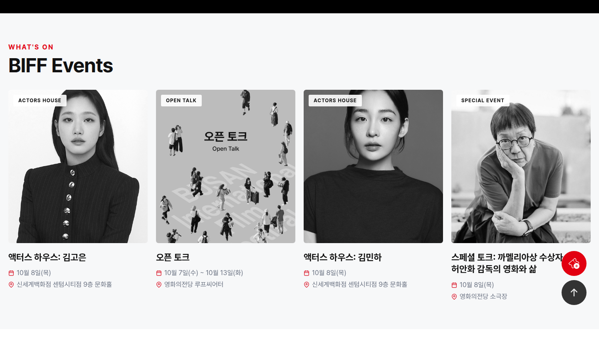

## 좋은 점
- 사진(335×369) 왼쪽 위에 흰 바탕(90%) 라벨. 12px w700 대문자, 자간 0.08em, 검정. 분류를 사진 위에 올려서 사진 아래 공간을 쓰지 않음.
- 사진 아래는 제목(22px w700), 그다음 날짜와 장소(16px #6a7282)가 한 줄씩. 네 장 모두 정보 순서가 같아서 서로 비교하기 쉬움.
- 카드에 테두리와 그림자가 없음. #f7f8f9 바탕 위에 사진과 글자만 있음.

## 우리 사이트에 쓰면
프로젝트 카드(`_includes/cards/project.html`). 상태(진행 중)는 사진 위 라벨로 올리고, 아래는 제목, 요약, 연도·분야 순서. 사진 없는 프로젝트는 카드 대신 목록 한 줄로 씀.

## 버릴 점
사진의 6px 라운드, 달력·위치 아이콘, 영어 eyebrow "WHAT'S ON", 슬라이더.

---

## 자동 수집 (capture.mjs)
<!-- 브라우저가 계산한 값입니다. 손으로 고치지 말고, 다시 뽑으려면 capture.mjs를 다시 실행하세요. -->

```text
화면 폭 1440px · selector 일치 1개

대상  div.event  1440×759
  색      color #ffffff · bg #f7f8f9
  배치    display block
  상자    padding 65.664px 0px
부모  div.main_page  1440×5062
  배치    display block
자식  1개: div 1440×628

글자 스타일 (큰 것부터)
  48px w700 lh 1.10 ls -0.021em Pretendard · #111111  ×1  "BIFF Events"
  22px w700 lh 1.30 ls 0 Pretendard · #111111  ×33  "아주담담-씬 스틸러: 배우 김재철"
  16px w700 lh 2.05 ls 0.15em Pretendard uppercase · #e20011  ×1  "WHAT'S ON"
  16px w400 lh 1.50 ls 0 Pretendard · #6a7282  ×66  "10월 12일(월)"
  12px w700 lh 1.00 ls 0.083em Pretendard uppercase · #111111  ×33  "TALK-TO-TALK"

색 (많이 쓰인 순)
  #111111  ×67  글자
  #6a7282  ×66  글자
  #ffffff 90%  ×33  배경
  #f7f8f9  ×1  배경
  #e20011  ×1  글자

간격 값(px ×횟수)  4×66  6×132  8×99  12×66  20×37  33×1  66×2  180×2
라운드  6px×33  3px×33
움직임 (하위 요소)
  div.thumb  transition all 0.3s ease  ×33
  div.badge  transition background-color, color 0.3s ease  ×33
  img  transition all 0.3s ease  ×33

이미지  img 33 · svg 66  (img: 335×369 cover, 335×369 cover, 335×369 cover, 335×369 cover, 335×369 cover)
로드된 웹폰트  Pretendard

구조
  div.event
    div
      div.tittle-area.container-xxl
        div.tit
          small  "WHAT'S ON"
          h2  "BIFF Events"
      div.container-xxl.swiper-container-xxl
        div.event-inner
          div.event_slide
            div.swiper-container.swiper-container-initialized
              … 1개
```
