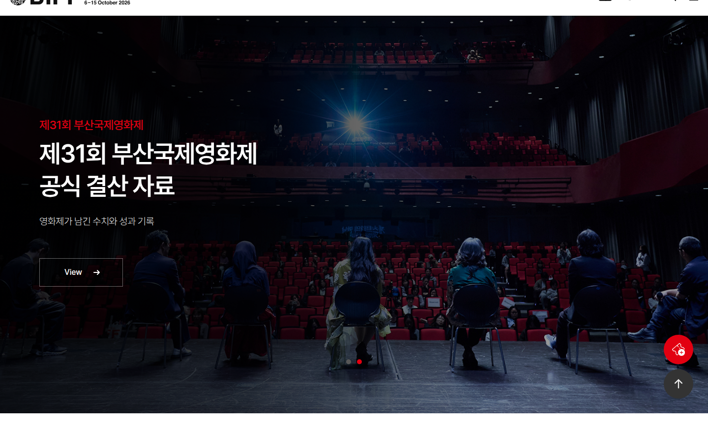

## 좋은 점
- 화면 폭 전체(1440×810)에 실제 현장 사진을 깔고 어둡게 덮음.
- 글은 세 줄. 사실 한 줄(24px w500 빨강 "제31회 부산국제영화제"), 제목(51px w600), 부제(20px w200) 순서. 버튼은 테두리만 있는 "View →" 하나.
- 격자, 빛 번짐, 떠다니는 로고 같은 장식이 없음.

## 우리 사이트에 쓰면
홈 히어로(`_includes/sections/hero.html`). 로고 대신 실제 활동 사진을 쓰고, 영어 eyebrow 대신 한국어 사실 한 줄을 씀. 버튼 2개는 링크 1개로 줄임.

## 버릴 점
자동으로 넘어가는 슬라이더. 사진 위에 글씨를 얹는 배치도 뺌(사진이 밝으면 안 읽힘). 우리는 사진과 글을 나란히 둠.
- (2026-11-16 바꿈) 사용자 요청으로 사진이 저절로 바뀌고, 직접 넘길 수도 있게 함. 6초마다 서서히 겹쳐 바뀜(옆으로 밀리는 움직임 없음). 넘기기는 사진 오른쪽 아래 캡션 줄 높이의 작은 버튼 묶음(이전 · 3 / 7 · 다음 · 멈춤)과 터치 밀기. 점(인디케이터)과 사진 양옆의 큰 화살표는 넣지 않음. 마우스를 올리면 멈추고, 동작 줄이기 설정이면 멈춘 채로 시작.

---

## 자동 수집 (capture.mjs)
<!-- 브라우저가 계산한 값입니다. 손으로 고치지 말고, 다시 뽑으려면 capture.mjs를 다시 실행하세요. -->

```text
화면 폭 1440px · selector 일치 1개

대상  div#visual  1440×810
  색      color #ffffff · bg #000000
  배치    display block
부모  div.main_page  1440×5062
  배치    display block
자식  1개: div.visual-wrap.slick-initialized 1440×810

글자 스타일 (큰 것부터)
  51px w600 lh 1.30 ls -0.035em Pretendard · #ffffff  ×2  "올해를 빛낸 주역들과 영예의 수상작"
  24px w500 lh 1.20 ls -0.025em Pretendard · #e20011  ×2  "제31회 부산국제영화제"
  20px w200 lh 1.45 ls -0.03em Pretendard · #ffffff  ×2  "영화의 바다와 함께한 영광의 순간들"
  16px w500 lh normal ls 0 Pretendard · #ffffff  ×2  "View"
  0px w400 lh NaN ls 0 Arial · null  ×2  "1"

색 (많이 쓰인 순)
  #ffffff  ×6  글자
  #e20011  ×3  글자/배경
  #ffffff 40%  ×2  선
  #000000  ×1  배경
  #575757  ×1  배경

간격 값(px ×횟수)  8×4  10×2  12×2  25×2  30×2  35×2  50×6  100×2  150×2
라운드  50%×2
움직임 (하위 요소)
  a  transition all 0.3s ease  ×2
  span.arr_icon  transition all 0.3s ease  ×2
  svg  transition all 0.3s ease  ×2
  div#slick-slide00.visual.visual-slider  transition opacity 0.5s ease
  button#slick-slide-control00  transition all 0.3s ease
  button#slick-slide-control01  transition all 0.3s ease

이미지  svg 2
로드된 웹폰트  Pretendard

구조
  div#visual
    div.visual-wrap.slick-initialized
      div.slick-list.draggable
        div.slick-track
          div#slick-slide00.visual.visual-slider
            div.container-xxl
              … 1개
          div#slick-slide01.visual.visual-slider
            div.container-xxl
              … 1개
      ul.slick-dots
        li
          button#slick-slide-control00  "1"
        li.slick-active
          button#slick-slide-control01  "2"
```
