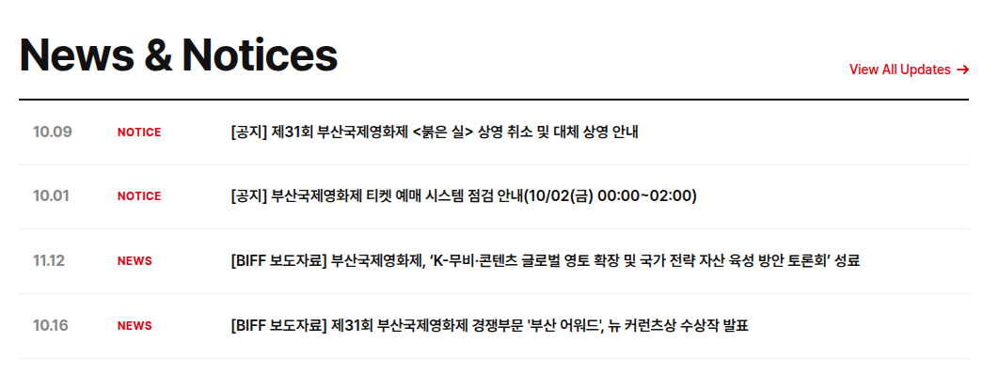

## 좋은 점
사용자 메모: "정보를 전달하는 방식이 직관적이고 눈에 잘 들어온다"
- 한 줄에 날짜(16px w700 #888), 분류(12px w700 대문자, 빨강 #e20011, 배경 없음), 제목(16px w600 #111)을 놓음. 세 칸 폭이 고정이라 세로로 훑으면 날짜와 분류가 한 줄로 맞춰짐.
- 줄 사이는 1px #f0f0f0 선, 머리줄 아래는 #111 선. 상자, 그림자, 배지 배경 없음.
- 머리줄은 왼쪽에 48px w700 제목, 같은 줄 오른쪽 끝에 14px 빨강 "View All Updates →".
- 히어로 바로 아래라서 첫 스크롤에 최신 소식 4건이 보임.

## 우리 사이트에 쓰면
홈 소식 섹션(`_includes/cards/news.html`, `_sass/components/_lists.scss`). 지금의 알약 배지와 mono 날짜 대신 씀. 홈에서 히어로 다음 순서.

## 버릴 점
영어 제목("News & Notices"), 오른쪽 광고 배너.

---

## 자동 수집 (capture.mjs)
<!-- 브라우저가 계산한 값입니다. 손으로 고치지 말고, 다시 뽑으려면 capture.mjs를 다시 실행하세요. -->

```text
화면 폭 1440px · selector 일치 1개

대상  div.news_section  1010×350
  색      color #ffffff
  배치    display flex · column · align normal · justify space-between
부모  div.news_notice_wrap  1400×350
  배치    display flex · row · align stretch · justify space-between · gap 40px
자식  2개: div.section_hd 1010×75 ul.news_list 1010×275

글자 스타일 (큰 것부터)
  48px w700 lh 1.10 ls -0.021em Pretendard · #111111  ×1  "News & Notices"
  16px w700 lh 1.50 ls -0.013em Pretendard · #888888  ×4  "10.09"
  16px w600 lh 1.50 ls 0 Pretendard · #111111  ×4  "[공지] 제31회 부산국제영화제 <붉은 실> 상영 "
  14px w500 lh 1.50 ls 0 Pretendard · #e20011  ×1  "View All Updates"
  12px w700 lh 1.50 ls 0.042em Pretendard · #e20011  ×4  "NOTICE"

색 (많이 쓰인 순)
  #111111  ×6  선/글자
  #e20011  ×5  글자
  #f0f0f0  ×4  선
  #888888  ×4  글자

간격 값(px ×횟수)  6×2  15×4  20×1
움직임 (하위 요소)
  a  transition background-color 0.3s ease  ×4
  a.btn_view_all  transition all 0.3s ease
  span.arr_icon  transition transform 0.3s ease

이미지  svg 1
로드된 웹폰트  Pretendard

구조
  div.news_section
    div.section_hd
      h2.tit  "News & Notices"
      a.btn_view_all  "View All Updates"
        span.arr_icon
          svg
    ul.news_list
      li
        a
          span.date  "10.09"
          span.cate  "NOTICE"
          span.tit  "[공지] 제31회 부산국제영화제 <붉은 실>"
      (같은 형태 ×4)
```
