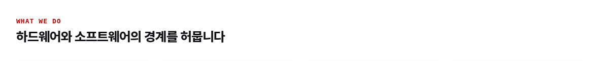

## 문제점
- "What we do" 같은 영어 eyebrow와 한국어 제목을 짝지음. 히어로에서는 학교·학과를 영어로 두 번(eyebrow, 캡션) 씀.
- 어느 동아리에 붙여도 말이 되는 추상 표현: "하드웨어와 소프트웨어의 경계를 허뭅니다"(섹션 제목), "새로운 가치를 탐구합니다"(히어로 리드).
- "꿈을 찾다, 아이디어를 현실로 만들다"(히어로 제목·tagline): 동아리 공식 슬로건이면 문구는 그대로 두고 위치·크기만 다시 생각.

## 우리 사이트에서 해당하는 곳
`content/pages/index.md`(hero, sections의 eyebrow·title), `_config.yml`의 tagline·description, `content/_data/interests.yml`

## 대신
- 사실로 말하기: 무엇을, 언제부터, 무엇을 만들었는지 쓰기. 예) "2005년부터", "IGZO TFT를 KLayout으로 직접 설계".
- 문구 윤문은 humanize-korean 스킬로 따로 함.

---

## 자동 수집 (capture.mjs)
<!-- 브라우저가 계산한 값입니다. 손으로 고치지 말고, 다시 뽑으려면 capture.mjs를 다시 실행하세요. -->

```text
화면 폭 1440px · selector 일치 4개 중 첫 번째

대상  div.section__head  1120×59
  색      color #141418
  배치    display flex · row · align flex-end · justify space-between · gap 16px
  상자    margin 0px 0px 32px
부모  div.container  1120×404
  배치    display block
자식  1개: div 411×59

글자 스타일 (큰 것부터)
  26px w800 lh 1.25 ls -0.02em Pretendard Variable · #141418  ×1  "하드웨어와 소프트웨어의 경계를 허뭅니다"
  13px w600 lh 1.75 ls 0.08em ui-monospace uppercase · #c80000  ×1  "What we do"

색 (많이 쓰인 순)
  #c80000  ×1  글자
  #141418  ×1  글자

간격 값(px ×횟수)  4×1  16×2  32×1
로드된 웹폰트  Pretendard Variable

구조
  div.section__head
    div
      p.eyebrow  "What we do"
      h2.section__title  "하드웨어와 소프트웨어의 경계를 허뭅니다"
```
