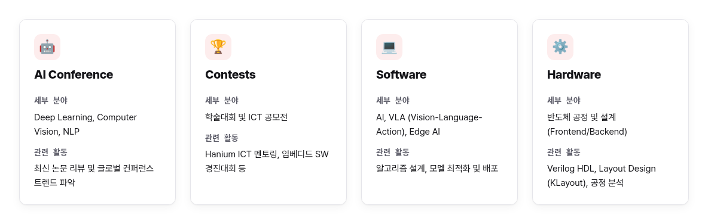

## 문제점
- 같은 모양 카드 4장(262px×4, gap 24px). 이모지(🤖🏆💻⚙️)를 브랜드색 7% 배경의 44px 둥근 네모(12px 라운드)에 넣음.
- 영어 제목(AI Conference, Contests…) 아래에 "세부 분야/관련 활동" dt/dd를 반복. 네 칸의 정보 구조가 똑같아서 훑어봐도 차이가 안 보임.
- 누를 곳이 없는데도 링크 카드와 같은 테두리·그림자 모양을 씀.

## 우리 사이트에서 해당하는 곳
`_includes/sections/interests.html`, `content/_data/interests.yml`, `_sass/components/_card.scss`의 `.card__icon`, `.card--interest`

## 대신
레퍼런스가 쌓이면 결정. 후보:
- 카드 없이 목록이나 표로 보여 주기.
- 분야마다 실제 결과물(대회명, 프로젝트 링크)로 보여 주기.
- 아이콘이 필요하면 이모지 대신 분야 고유의 그림(회로 기호, 레이아웃 조각) 쓰기.

---

## 자동 수집 (capture.mjs)
<!-- 브라우저가 계산한 값입니다. 손으로 고치지 말고, 다시 뽑으려면 capture.mjs를 다시 실행하세요. -->

```text
화면 폭 1440px · selector 일치 1개

대상  div.grid.grid--4  1120×313
  색      color #141418
  배치    display grid · cols 262px×4 · rows 313px · gap 24px
부모  div.container  1120×404
  배치    display block
자식  4개: article.card.card--interest 262×313×4

글자 스타일 (큰 것부터)
  22.4px w400 lh 1.75 ls 0 Pretendard Variable · #c80000  ×4  "🤖"
  20px w800 lh 1.25 ls -0.02em Pretendard Variable · #141418  ×4  "AI Conference"
  15px w400 lh 1.60 ls 0 Pretendard Variable · #141418  ×8  "Deep Learning, Computer Visi"
  13px w600 lh 1.75 ls 0 ui-monospace · #5d5d69  ×8  "세부 분야"

색 (많이 쓰인 순)
  #141418  ×12  글자
  #5d5d69  ×8  글자
  #ffffff  ×4  배경
  #e5e5ea  ×4  선
  #c80000  ×4  글자
  #dc0000 7%  ×4  배경

간격 값(px ×횟수)  4×8  8×8  12×8  24×18
라운드  12px×8
그림자
  ×4  rgba(0, 0, 0, 0.04) 0px 1px 2px 0px, rgba(0, 0, 0, 0.05) 0px 4px 16px 0px
움직임 (하위 요소)
  article.card.card--interest  transition transform, box-shadow, border-color 0.18s cubic-bezier(0.2, 0.7, 0.2, 1)  ×4
로드된 웹폰트  Pretendard Variable

구조
  div.grid.grid--4
    article.card.card--interest
      span.card__icon  "🤖"
      h3.card__title  "AI Conference"
      dl.card__dl
        dt  "세부 분야"
        dd  "Deep Learning, Computer "
        dt  "관련 활동"
        dd  "최신 논문 리뷰 및 글로벌 컨퍼런스 트렌드 "
    (같은 형태 ×4)
```
