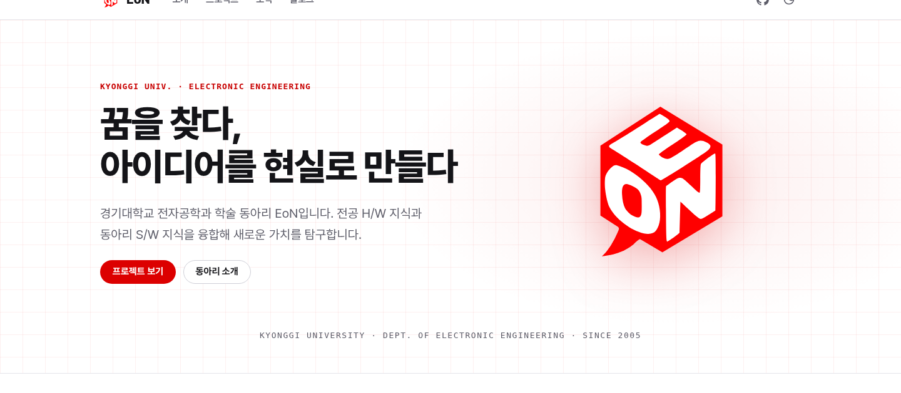

## 문제점
- 생성형 랜딩 페이지의 기본 순서를 그대로 씀: 영어 eyebrow(mono 13px 대문자, 빨강) → 60px w800 ls -0.035em 제목 → 20px 회색 리드 → 알약형(999px) 빨강/고스트 버튼 2개 → 오른쪽 로고.
- 배경: 빨강 7% radial glow + 36px 격자선(빨강 6%).
- 로고 img: `hero-float` 6s 무한 애니메이션 + 빨간 drop-shadow.
- 맨 아래 mono 대문자(자간 0.12em) 캡션이 eyebrow와 같은 정보(학교·학과)를 한 번 더 반복.

## 우리 사이트에서 해당하는 곳
`_includes/sections/hero.html`, `_sass/components/_hero.scss`, `content/pages/index.md`의 `hero:`

## 대신
레퍼런스가 쌓이면 결정. 후보:
- 동아리 세계에서 가장 특징적인 것 하나로 시작: 실제 활동 사진, 실물(보드·레이아웃 캡처), 또는 2005년부터 이어진 연혁 같은 사실.
- glow, 둥둥 뜨는 로고, 버튼 2개 중 적어도 둘은 뺀다.

---

## 자동 수집 (capture.mjs)
<!-- 브라우저가 계산한 값입니다. 손으로 고치지 말고, 다시 뽑으려면 capture.mjs를 다시 실행하세요. -->

```text
화면 폭 1440px · selector 일치 1개

대상  section.hero  1440×567
  색      color #141418 · bg-image radial-gradient(45% 60% at 75% 45%, rgba(220, 0, 0, 0.07), rgba(0, 0, 0, 0) 70%), linear-gradient(rgba(220, 0, 0, 0.06) 1px, rgba(0, 0, 0, 0) 1px), linear-gradient(90deg, rgba(220, 0, 0, 0.06) 1px, rgba(0, 0, 0, 0) 1px)
  배치    display block
  상자    padding 96px 0px 48px · border-bottom 1px solid #e5e5ea
부모  main#main  1440×2441
  배치    display block
자식  2개: div.container.hero__inner 1120×327 p.container.hero__caption 1120×23

글자 스타일 (큰 것부터)
  60px w800 lh 1.15 ls -0.035em Pretendard Variable · #141418  ×1  "꿈을 찾다, 아이디어를 현실로 만들다"
  20px w400 lh 1.70 ls 0 Pretendard Variable · #5d5d69  ×1  "경기대학교 전자공학과 학술 동아리 EoN입니다. 전"
  15px w700 lh 1.00 ls 0 Pretendard Variable · #ffffff  ×1  "프로젝트 보기"
  15px w700 lh 1.00 ls 0 Pretendard Variable · #141418  ×1  "동아리 소개"
  13px w600 lh 1.75 ls 0.08em ui-monospace uppercase · #c80000  ×1  "Kyonggi Univ. · Electronic E"
  13px w400 lh 1.75 ls 0.12em ui-monospace · #5d5d69  ×1  "KYONGGI UNIVERSITY · DEPT. O"

색 (많이 쓰인 순)
  #141418  ×2  글자
  #5d5d69  ×2  글자
  #ffffff  ×2  글자/배경
  #e5e5ea  ×1  선
  #c80000  ×1  글자
  #dc0000  ×1  배경
  #d0d0d8  ×1  선

간격 값(px ×횟수)  8×4  11×4  12×3  19×4  24×2  48×3  72×1  96×1
라운드  999px×2
움직임 (하위 요소)
  a.btn.btn--primary  transition background, border-color, transform 0.18s cubic-bezier(0.2, 0.7, 0.2, 1)
  a.btn.btn--ghost  transition background, border-color, transform 0.18s cubic-bezier(0.2, 0.7, 0.2, 1)
  img  animation hero-float 6s

이미지  img 1  (img: 320×320 fill)
로드된 웹폰트  Pretendard Variable

구조
  section.hero
    div.container.hero__inner
      div.hero__text
        p.eyebrow  "Kyonggi Univ. · Electron"
        h1.hero__title  "꿈을 찾다, 아이디어를 현실로 만들다"
        p.hero__lead  "경기대학교 전자공학과 학술 동아리 EoN입니"
        div.btn-row
          a.btn.btn--primary  "프로젝트 보기"
          a.btn.btn--ghost  "동아리 소개"
      div.hero__art
        img
    p.container.hero__caption  "KYONGGI UNIVERSITY · DEP"
```
