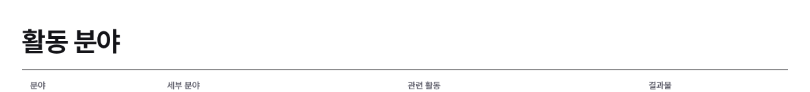

줄기가 지나가는 순간(localhost, 선이 화면에 들어오고 0.35초 뒤). 선 위에 파랑·자주 줄기 두 개가 오른쪽으로 가는 중:


## 좋은 점
사용자 메모: "작게 빠르게 하는건 왼쪽에서 오른쪽으로 가는게 좋은거 같아." 소개 페이지 '활동 분야' 제목줄 아래 선을 보고 한 말.
- 방향: 섹션 제목줄 아래 1px 선을 타고 왼쪽 → 오른쪽(글 읽는 쪽). 둥근 머리가 오른쪽, 뾰족한 꼬리가 왼쪽.
- 크기: 머리 반지름 2~3px, 줄기 길이 90~170px(선 1120px 기준). 선 두께(1px)보다 조금 굵은 정도.
- 빠르기: 700px/초, 선 하나를 1~2.6초에 지나감. 빠르게 들어와 끝에서 조금 늦춰짐(cubic-bezier(0.35, 0, 0.25, 1)).
- 60% 확률로 두 번째 줄기가 0.12~0.3초 뒤 조금 작고 느리게(×0.75 굵기, ×1.12 시간) 위아래 2px 안으로 비켜 따라옴.
- 선이 화면에 처음 들어올 때 한 번만.

## 우리 사이트에 쓰면
`assets/js/modules/wind-lines.js`: 섹션 제목줄 아래 선과 푸터 위 선 모두 오른쪽(→)으로 보냄(푸터도 사용자가 →로 정함).
그 전에는 '전체 보기 →'가 없는 줄과 푸터를 왼쪽(←)으로 보냈는데, 이 레퍼런스로 되돌림.

## 버릴 점
- 선마다 방향을 →·←로 바꾸는 규칙('전체 보기' 링크가 있는지, 푸터인지에 따라). 한 페이지에서 선끼리 방향이 달라짐.

---

## 자동 수집 (capture.mjs)
<!-- 브라우저가 계산한 값입니다. 손으로 고치지 말고, 다시 뽑으려면 capture.mjs를 다시 실행하세요. -->

```text
화면 폭 1440px · selector 일치 1개

대상  div.section__head  1120×71
  색      color #141418
  배치    display flex · row · align flex-end · justify space-between · gap 16px
  상자    padding 0px 0px 16px · border-bottom 1px solid #141418
부모  div.container  1120×450
  배치    display block
자식  1개: div 143×54

글자 스타일 (큰 것부터)
  40px w700 lh 1.25 ls -0.025em Pretendard Variable · #141418  ×1  "활동 분야"

색 (많이 쓰인 순)
  #141418  ×2  선/글자

간격 값(px ×횟수)  4×1  16×3
로드된 웹폰트  Pretendard Variable

구조
  div.section__head
    div
      h2.section__title  "활동 분야"
```
