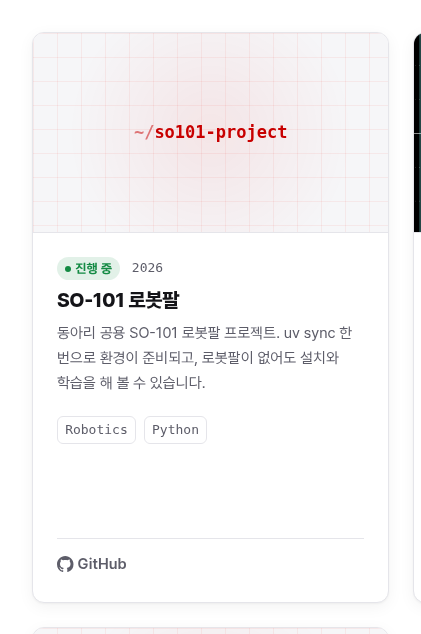

## 문제점
- 프로젝트 카드 4장 중 3장이 사진 대신 격자 + 빨강 radial glow + mono `~/repo-name`으로 이미지 칸(16:9, 200px)을 채움. 정보 없는 장식.
- 같은 페이지에서 실제 이미지(IGZO TFT 레이아웃)가 있는 카드 하나만 눈에 확 띔. 실물 이미지가 가장 강한 차별점이라는 증거.

## 우리 사이트에서 해당하는 곳
`_includes/cards/project.html`, `_sass/components/_card.scss`의 `.card__placeholder`, `content/images/projects/`

## 대신
- 이미지가 없으면 이미지 칸 자체를 없앰(텍스트 카드).
- 프로젝트마다 실물 사진, 스크린샷, 회로·레이아웃 캡처를 한 장씩 모으기.

---

## 자동 수집 (capture.mjs)
<!-- 브라우저가 계산한 값입니다. 손으로 고치지 말고, 다시 뽑으려면 capture.mjs를 다시 실행하세요. -->

```text
화면 폭 1440px · selector 일치 3개 중 첫 번째

대상  article.card.card--project  357×570
  색      color #141418 · bg #ffffff
  배치    display flex · column · align normal · justify normal
  상자    border 1px solid #e5e5ea · radius 12px · shadow rgba(0, 0, 0, 0.04) 0px 1px 2px 0px, rgba(0, 0, 0, 0.05) 0px 4px 16px 0px
  움직임  transition transform, box-shadow, border-color 0.18s cubic-bezier(0.2, 0.7, 0.2, 1)
부모  div.grid.grid--3  1120×1053
  배치    display grid · cols 357px×3 · rows 570px 459px · gap 24px
자식  2개: div.card__media 355×200 div.card__body 355×369

글자 스타일 (큰 것부터)
  20px w800 lh 1.25 ls -0.02em Pretendard Variable · #141418  ×1  "SO-101 로봇팔"
  17px w600 lh 1.75 ls 0 ui-monospace · #c80000  ×1  "so101-project"
  15px w600 lh 1.75 ls 0 Pretendard Variable · #5d5d69  ×1  "GitHub"
  15px w400 lh 1.65 ls 0 Pretendard Variable · #5d5d69  ×1  "동아리 공용 SO-101 로봇팔 프로젝트. uv s"
  13px w700 lh 1.40 ls 0 Pretendard Variable · #138a43  ×1  "진행 중"
  13px w400 lh 1.75 ls 0 ui-monospace · #5d5d69  ×3  "2026"

색 (많이 쓰인 순)
  #e5e5ea  ×5  선
  #5d5d69  ×5  글자
  #ffffff  ×1  배경
  #f6f6f8  ×1  배경
  #c80000  ×1  글자
  #138a43  ×1  글자
  #138a43 12%  ×1  배경
  #141418  ×1  글자

간격 값(px ×횟수)  2×4  3×2  4×2  5×2  7×4  8×7  12×3  16×6  24×4  86×1
라운드  6px×2  12px×1  999px×1
그림자
  ×1  rgba(0, 0, 0, 0.04) 0px 1px 2px 0px, rgba(0, 0, 0, 0.05) 0px 4px 16px 0px

이미지  svg 1
로드된 웹폰트  Pretendard Variable

구조
  article.card.card--project
    div.card__media
      span.card__placeholder  "so101-project"
    div.card__body
      div.meta
        span.badge.badge--active  "진행 중"
        span  "2026"
      h3.card__title
        a.card__link  "SO-101 로봇팔"
      p.card__text  "동아리 공용 SO-101 로봇팔 프로젝트. "
      ul.tags
        li  "Robotics"
        (같은 형태 ×2)
      div.card__actions
        a  "GitHub"
          svg.icon
```
