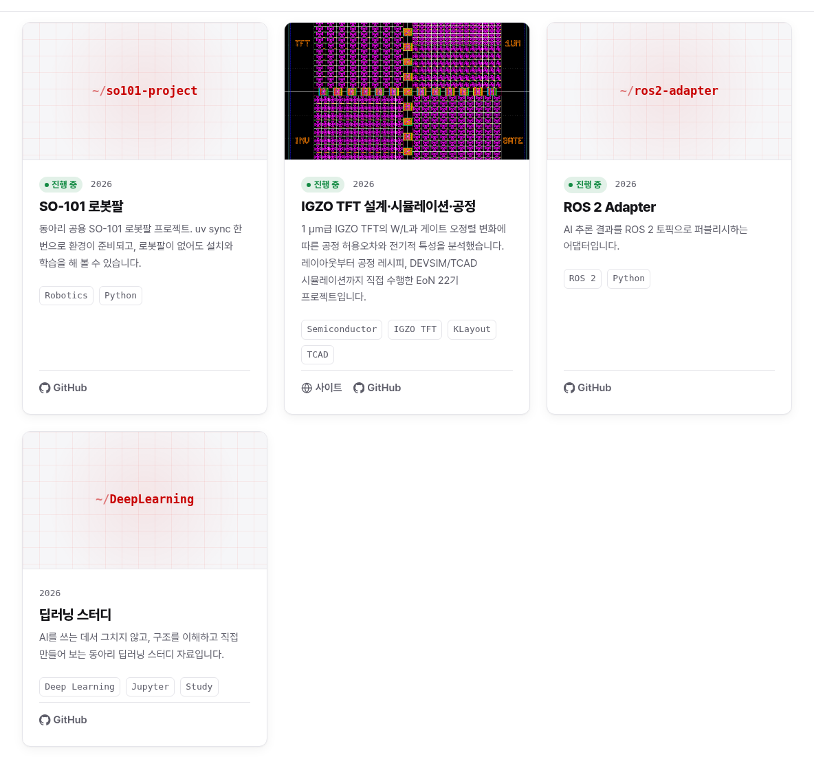

## 문제점
- 모든 카드가 1px #e5e5ea 테두리 + 12px 라운드 + 이중 그림자(0 1px 2px 4% / 0 4px 16px 5%) + hover 때 3px 떠오름(0.18s). 활동 분야·프로젝트·글 카드가 전부 같은 처리.
- 3열이 모두 357px로 같아서 중요도 차이가 안 보임.
- 카드 한 장에 작은 장식이 많음: 초록 알약 배지, mono 알약 태그, 액션 줄 위 구분선.
- 간격 값이 2·3·4·5·7·8·12·16·24px로 잘게 흩어짐.

## 우리 사이트에서 해당하는 곳
`_sass/components/_card.scss`의 `.card`, `_sass/_tokens.scss`의 `--shadow`·`--radius`

## 대신
레퍼런스가 쌓이면 결정. 후보:
- 테두리·그림자·라운드 중 하나만 남기기.
- 대표 프로젝트 하나를 크게 보여 주기.

---

## 자동 수집 (capture.mjs)
<!-- 브라우저가 계산한 값입니다. 손으로 고치지 말고, 다시 뽑으려면 capture.mjs를 다시 실행하세요. -->

```text
화면 폭 1440px · selector 일치 1개

대상  div.grid.grid--3  1120×1053
  색      color #141418
  배치    display grid · cols 357px×3 · rows 570px 459px · gap 24px
부모  div.container  1120×1053
  배치    display block
자식  4개: article.card.card--project 357×570×3 article.card.card--project 357×459

글자 스타일 (큰 것부터)
  20px w800 lh 1.25 ls -0.02em Pretendard Variable · #141418  ×4  "SO-101 로봇팔"
  17px w600 lh 1.75 ls 0 ui-monospace · #c80000  ×3  "so101-project"
  15px w600 lh 1.75 ls 0 Pretendard Variable · #5d5d69  ×5  "GitHub"
  15px w400 lh 1.65 ls 0 Pretendard Variable · #5d5d69  ×4  "동아리 공용 SO-101 로봇팔 프로젝트. uv s"
  13px w700 lh 1.40 ls 0 Pretendard Variable · #138a43  ×3  "진행 중"
  13px w400 lh 1.75 ls 0 ui-monospace · #5d5d69  ×15  "2026"

색 (많이 쓰인 순)
  #5d5d69  ×24  글자
  #e5e5ea  ×23  선
  #ffffff  ×4  배경
  #f6f6f8  ×4  배경
  #141418  ×4  글자
  #c80000  ×3  글자
  #138a43  ×3  글자
  #138a43 12%  ×3  배경

간격 값(px ×횟수)  2×22  3×6  4×10  5×6  7×22  8×26  12×12  16×20  24×18  86×1  111×1
라운드  6px×11  12px×4  999px×3
그림자
  ×4  rgba(0, 0, 0, 0.04) 0px 1px 2px 0px, rgba(0, 0, 0, 0.05) 0px 4px 16px 0px
움직임 (하위 요소)
  article.card.card--project  transition transform, box-shadow, border-color 0.18s cubic-bezier(0.2, 0.7, 0.2, 1)  ×4

이미지  svg 5 · img 1  (img: 355×199 cover)
로드된 웹폰트  Pretendard Variable

구조
  div.grid.grid--3
    article.card.card--project
      div.card__media
        span.card__placeholder  "so101-project"
      div.card__body
        div.meta
          span.badge.badge--active  "진행 중"
          span  "2026"
        h3.card__title
          a.card__link  "SO-101 로봇팔"
        p.card__text  "동아리 공용 SO-101 로봇팔 프로젝트. "
        ul.tags
          li  "Robotics"
          (같은 형태 ×2)
        div.card__actions
          a  "GitHub"
            svg.icon
    (같은 형태 ×4)
```
