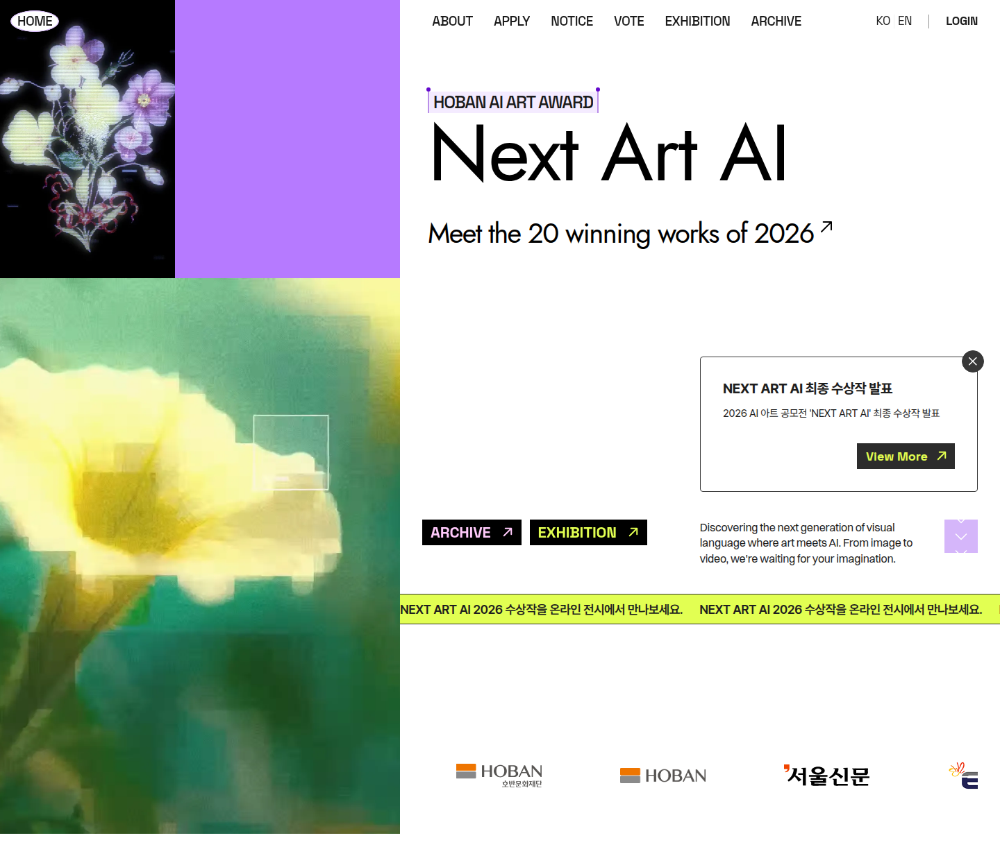

## 좋은 점
사용자 메모: "깔끔한 느낌이 너무 좋다". 어떤 속성인지는 아직 확인 전이고, 아래는 선 구분, 가늘고 큰 제목, 무채색 바탕으로 해석한 것.
- 화면을 2:3으로 나눔. 왼쪽 2/5는 이미지와 영상으로 꽉 채우고(여백·라운드 없음), 오른쪽 3/5에 글을 둠.
- 이름이 가장 큼(115px w400, 자간 -0.015em). 굵기가 400이라 크기가 커도 무거워 보이지 않음.
- 둘째 줄은 지금 볼 것을 가리키는 링크 한 줄(40px w400 "Meet the 20 winning works of 2026 ↗").
- 버튼은 라운드 없는 검정 상자에 ↗를 붙임.

## 우리 사이트에 쓰면
홈 히어로. 왼쪽에 클린룸 사진, 오른쪽에 EoN(크고 가늘게), 구호, 지금 진행 중인 프로젝트 링크 하나.

## 버릴 점
형광 연두·분홍 강조색, 픽셀 그래픽, 흐르는 띠(marquee), 팝업 공지, Jost·Space Grotesk 글꼴(한글이 없음).

---

## 자동 수집 (capture.mjs)
<!-- 브라우저가 계산한 값입니다. 손으로 고치지 말고, 다시 뽑으려면 capture.mjs를 다시 실행하세요. -->

```text
화면 폭 1440px · selector 일치 1개

대상  section.w-full  1440×1202
  색      color #000000
  배치    display block
부모  main  1440×3668
  배치    display block
자식  1개: div.hidden.min-h-[133.6vh] 1440×1202

글자 스타일 (큰 것부터)
  115.2px w400 lh 1.00 ls -0.015em Jost · #000000  ×1  "Next Art AI"
  40px w400 lh 1.25 ls -0.04em Jost · #000000  ×1  "Meet the 20 winning works of"
  25px w500 lh 0.90 ls -0.05em Space Grotesk · #1a1a1a  ×2  "HOBAN AI ART AWARD"
  22px w700 lh 1.50 ls -0.01em Space Grotesk · #ffc9fa  ×2  "ARCHIVE"
  22px w700 lh 1.50 ls -0.01em Space Grotesk · #e2ff51  ×2  "EXHIBITION"
  20px w700 lh 1.35 ls -0.03em Pretendard Variable · #1e1e1e  ×1  "NEXT ART AI 최종 수상작 발표"
  18px w700 lh 1.50 ls 0 Space Grotesk · #e2ff51  ×2  "View More"
  18px w600 lh 1.50 ls -0.03em Pretendard Variable · #1e1e1e  ×8  "NEXT ART AI 2026 수상작을 온라인 전시"
  16px w400 lh 1.40 ls -0.015em switzer · #1e1e1e  ×1  "Discovering the next generat"
  15px w400 lh 1.40 ls -0.02em Pretendard Variable · #1e1e1e  ×1  "2026 AI 아트 공모전 'NEXT ART AI'"
  13px w400 lh 1.30 ls -0.015em googleSansCode · #000000  ×2  "Click!"
  13px w400 lh 1.30 ls -0.03em Space Mono · #000000  ×2  "Supported by"

색 (많이 쓰인 순)
  #1e1e1e  ×11  글자
  #000000  ×8  글자/배경
  #e2ff51  ×4  글자
  #ffffff  ×3  배경
  #383838  ×3  선/배경
  #1a1a1a  ×2  글자
  #b98ee8  ×2  배경
  #6408cd  ×2  배경
  #2c2c2c  ×2  배경/선
  #ffc9fa  ×2  글자

간격 값(px ×횟수)  2×2  4×8  6×5  8×8  12×11  16×8  22×2  24×10  32×15  40×6
라운드  3.35544e+07px×3  4px×1
그림자
  ×2  rgba(0, 0, 0, 0) 0px 0px 0px 0px, rgba(0, 0, 0, 0) 0px 0px 0px 0px, rgba(0, 0, 0, 0) 0px 0px 0px 0px, rgba(0, 0, 0, 0) 0px 0px 0px 0px, rgba(0, 0, 0, 0.18) 0px 10px 20px 0px
움직임 (하위 요소)
  a.relative.inline-flex  transition color, background-color, border-color, outline-color, text-decoration-color, fill, stroke, --tw-gradient-from, --tw-gradient-via, --tw-gradient-to 0.4s cubic-bezier(0.7, -0.01, 0.56, 1)  ×2
  span.pointer-events-none.absolute  transition opacity 0.4s cubic-bezier(0.4, 0, 0.2, 1)  ×2
  a.mt-8.flex  transition opacity 0.15s cubic-bezier(0.4, 0, 0.2, 1)
  a.group/cta.relative  transition color, background-color, border-color, outline-color, text-decoration-color, fill, stroke, --tw-gradient-from, --tw-gradient-via, --tw-gradient-to 0.4s cubic-bezier(0.7, -0.01, 0.56, 1)
  div.absolute.inset-0  animation cue-spin 12s
  div.flex.animate-[chevron-fall_2.5s_linear_infinite]  animation chevron-fall 2.5s

이미지  video 3 · canvas 2 · svg 11 · img 32  (img: 123×35 contain, 123×22 contain, 123×31 contain, 123×46 contain, 123×35 contain)
로드된 웹폰트  Space Grotesk, Jost, Space Mono, googleSansCode, switzer, Pretendard Variable

구조
  section.w-full
    div.hidden.min-h-[133.6vh]
      div.flex.w-2/5
        div.flex.h-[44.5vh]
          div.h-full.w-[43.75%]
            div
              … 2개
          div.h-full.w-[56.25%]
            div
              … 1개
        div.w-full.flex-1
          div
            video
            canvas
      div.flex.w-3/5
        div.flex.h-screen
          div.flex.h-[44.5vh]
            div.overflow-x-hidden.p-10
              … 1개
          div.flex-1
          div.flex.items-start
            div.mr-[76px].flex
              … 2개
            div.ml-auto.flex
              … 2개
          div.w-full.overflow-hidden
            div.flex.w-max
              … 2개
        div.flex.flex-1
          div.w-full.px-8
            div.relative.py-6
              … 2개
```
