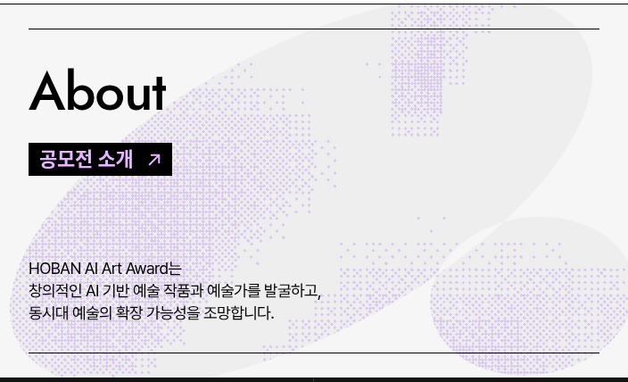

## 좋은 점
- 상자 대신 위아래 1px #000 선으로만 구역을 나눔. 안쪽 여백은 위아래 32px, 좌우 0.
- 제목(60px w500) 아래에 검정 바탕 CTA, 설명(18px w400)은 맨 아래. 위아래로 벌려(space-between) 두 선 사이를 채움.
- 그림자, 라운드 없음.

## 우리 사이트에 쓰면
섹션 머리줄 아래 1px 검정 선, 카드 테두리·그림자 제거, 목록 줄 구분선.

## 버릴 점
배경의 점무늬 타원 그래픽, 마우스를 따라오는 "Click!".

---

## 자동 수집 (capture.mjs)
<!-- 브라우저가 계산한 값입니다. 손으로 고치지 말고, 다시 뽑으려면 capture.mjs를 다시 실행하세요. -->

```text
화면 폭 1440px · selector 일치 1개

대상  div.relative.flex  640×364
  색      color #000000
  배치    display flex · column · align normal · justify space-between
  상자    padding 32px 0px · border-top 1px solid #000000 · border-bottom 1px solid #000000
부모  div.group.relative  720×420
  배치    display block
자식  3개: svg.pointer-events-none.absolute 63×63 div.flex.items-start 640×132 p.text-[16px].leading-[1.6] 640×76

글자 스타일 (큰 것부터)
  60px w500 lh 1.25 ls -0.02em Jost · #000000  ×2  "About"
  22px w700 lh 1.50 ls -0.01em Space Grotesk · #e5b5ff  ×2  "공모전 소개"
  18px w400 lh 1.40 ls -0.03em Pretendard Variable · #000000  ×1  "HOBAN AI Art Award는 창의적인 AI "
  13px w400 lh 1.30 ls -0.015em googleSansCode · #000000  ×1  "Click!"

색 (많이 쓰인 순)
  #000000  ×6  선/글자/배경
  #e5b5ff  ×2  글자
  #ffffff  ×1  배경

간격 값(px ×횟수)  4×2  6×2  8×1  12×3  16×2  20×2  32×2
그림자
  ×1  rgba(0, 0, 0, 0) 0px 0px 0px 0px, rgba(0, 0, 0, 0) 0px 0px 0px 0px, rgba(0, 0, 0, 0) 0px 0px 0px 0px, rgba(0, 0, 0, 0) 0px 0px 0px 0px, rgba(0, 0, 0, 0.18) 0px 10px 20px 0px
움직임 (하위 요소)
  svg.pointer-events-none.absolute  transition opacity 0.3s cubic-bezier(0.4, 0, 0.2, 1)
  a.relative.inline-flex  transition color, background-color, border-color, outline-color, text-decoration-color, fill, stroke, --tw-gradient-from, --tw-gradient-via, --tw-gradient-to 0.4s cubic-bezier(0.7, -0.01, 0.56, 1)
  span.pointer-events-none.absolute  transition opacity 0.4s cubic-bezier(0.4, 0, 0.2, 1)

이미지  svg 2
로드된 웹폰트  Space Grotesk, Jost, Space Mono, googleSansCode, switzer, Pretendard Variable

구조
  div.relative.flex
    svg.pointer-events-none.absolute
    div.flex.items-start
      div.flex.flex-col
        div
          h2.font-jost.text-[40px]
            span.relative.inline-block
              … 2개
        span.group/cta.relative
          a.relative.inline-flex
            span.relative.z-10
              … 1개
            svg.relative.z-10
          span.pointer-events-none.absolute  "Click!"
    p.text-[16px].leading-[1.6]  "HOBAN AI Art Award는 창의적인"
```
