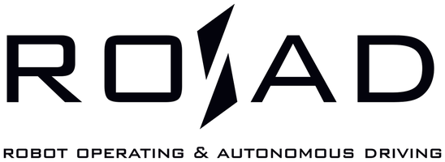
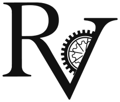
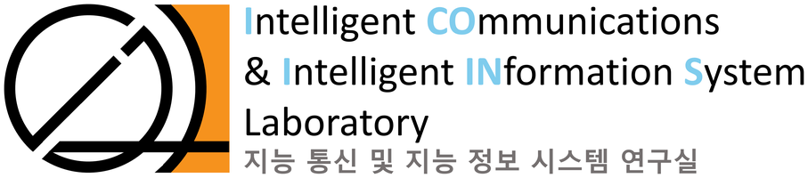
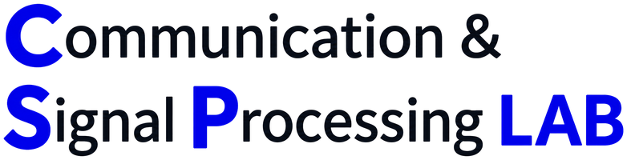
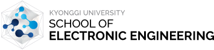
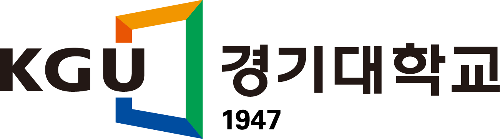

전자공학부 동아리 4곳과 연구실 7곳, 59명이 올 한 해 만든 결과물을 한자리에 내놓습니다.

EoN이 처음 기획해 주관을 맡았고, 반도체부트캠프사업단과 전자공학부가 함께하면서 학부 전체가 참여하는 행사가 되었습니다.
올해가 첫 회이고, 매년 연말에 여는 정기 행사로 이어 가려고 합니다.

## 행사 안내

| 항목 | 내용 |
|---|---|
| 관람 | 전자공학부 재학생·교수·교직원, 교내 구성원 누구나. 신청 없이 오시면 됩니다 |
| 참여 혜택 | 방명록 작성 시 Welcome 선물 증정(선착순 48명), 부스 관람 및 만족도 조사 참여시 경품 추첨 |
| 주관 | EoN |
| 협력 | 경기대학교 전자공학부, 공학교육혁신센터, 반도체부트캠프사업단 |

## 무엇을 볼 수 있나요

- **포스터와 논문·보고서**: 단체마다 한 해 동안 한 연구와 프로젝트를 A1 포스터와 보고서로 정리했습니다.
- **반도체 소자 실물**: EoN이 직접 설계하고 공정을 거쳐 만든 소자를 가져옵니다.
- **로봇 시연**: 사족보행 로봇 Unitree Go2와 로봇팔 SO-ARM101이 움직이는 모습을 정해진 시간에 보여 드립니다. [시연 시간과 장소 보기]({{ '/news/2026/ee-exhibition-posters/demos/' | relative_url }})
- **영상 상영**: 반도체 관련 영상을 포함해 단체별 영상을 상영합니다.

별도 발표 순서는 없습니다. 열려 있는 시간 아무 때나 들러 부스 전시를 관람하면 됩니다.

현장 전시와 함께 [온라인 전시]({{ '/news/2026/ee-exhibition-posters/' | relative_url }})도 열립니다. 포스터 22장과 FPGA 개발 보드 보고서의 요약과 PDF 원본을 볼 수 있습니다.

## 관람 및 이벤트

- **방명록 & Welcome 선물**: 전시장에서 방명록을 작성하시면 선착순 48분께 소정의 Welcome 선물을 드립니다.
- **부스별 QR 방문 인증**: 각 부스에 비치된 QR 코드를 스캔해 방문한 부스를 기록할 수 있습니다.
- **만족도 조사 & 경품 추첨**: 관람 후 부스 참여와 함께 만족도 조사까지 마치면 경품 추첨에 자동 등록됩니다. (7만 원 상당 경품, 6인)

## 참여 단체

- **동아리**: EoN, EEI, ROAD, KROWD
- **연구실**: 차세대반도체디바이스 연구실, ASNL, RV Lab, SIDL, I2_COINS_Lab, CSP, 파동응용연구센터

  
  
  
  
  
  
  SIDL
  
  

문의는 [kyonggieon@gmail.com](mailto:kyonggieon@gmail.com)으로 보내 주세요.

  
  
  
  

> 본 연구는 한국산업기술진흥원(KIAT)이 지원하고 경기대학교가 수행하는 「첨단산업 인재양성 부트캠프사업」의 지원을 받아 수행되었음
