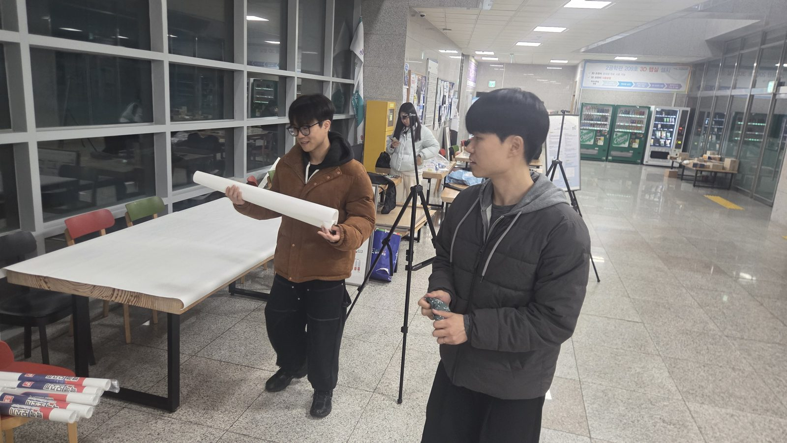
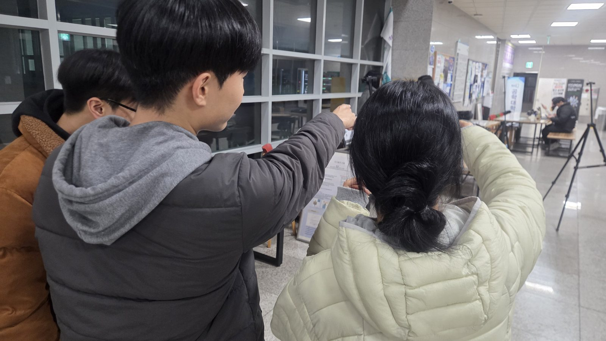
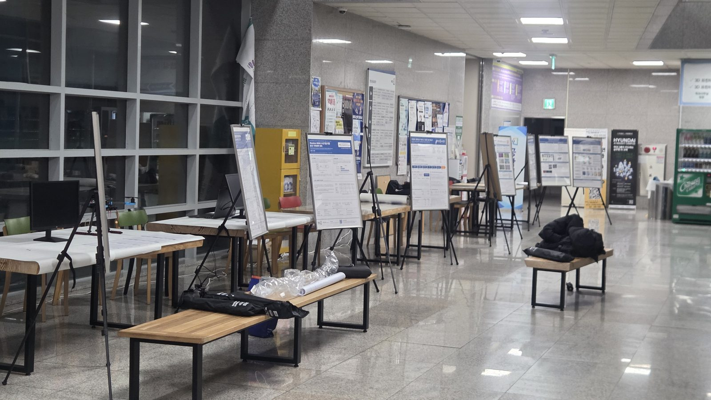
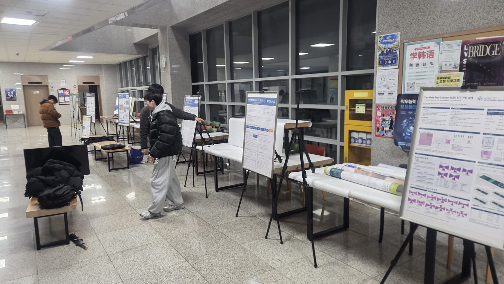
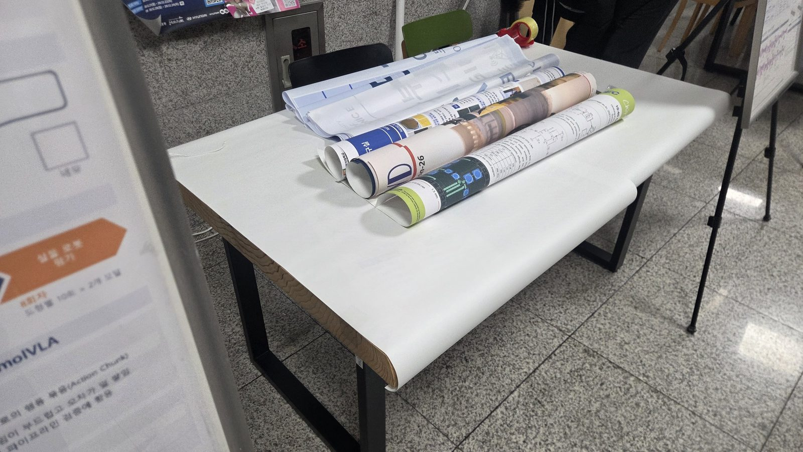
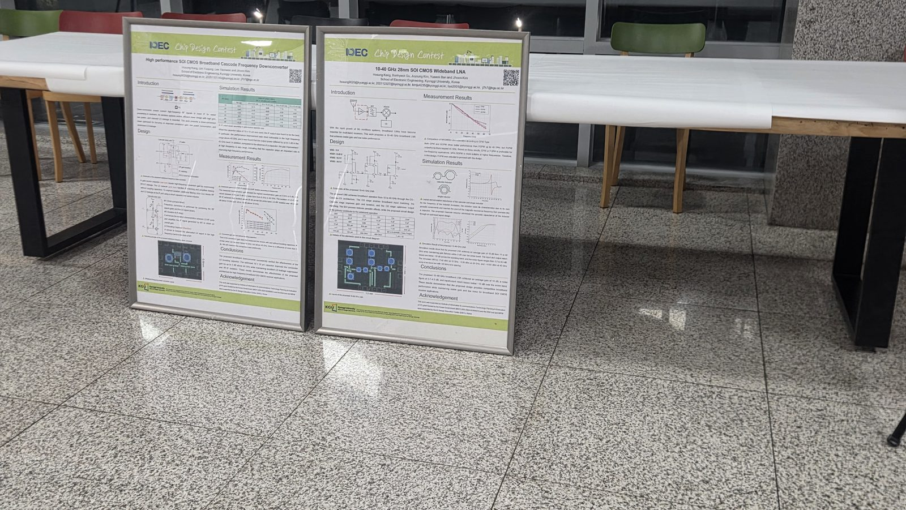
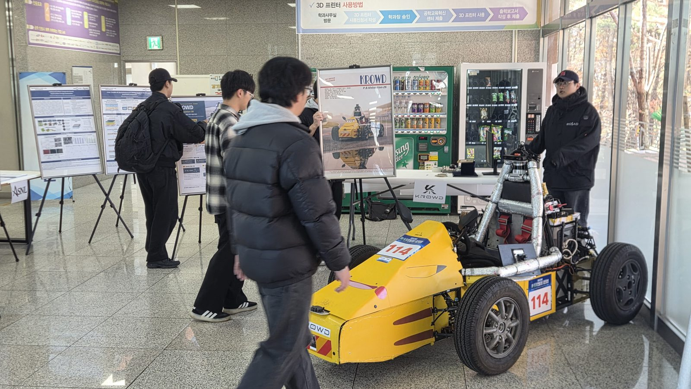
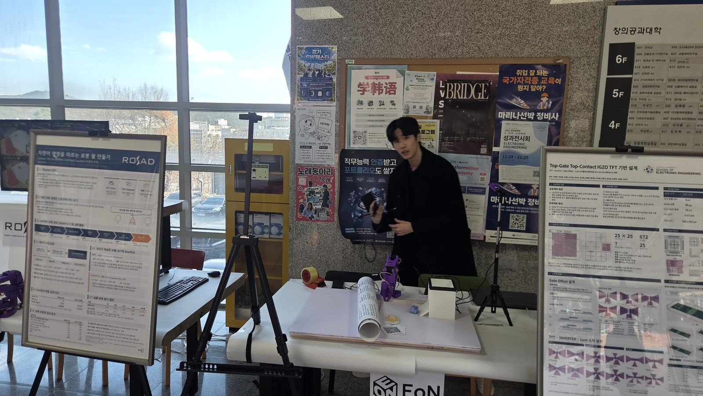

[2026 전자공학부 성과전시회]({{ '/news/2026/ee-exhibition/' | relative_url }})는 11월 24일(화) 12시에 문을 열었습니다.
설치는 하루 전인 23일(월) 오후, 전시장인 제2공학관 1층 로비에서 시작했습니다.

## 23일 오후: 자리 잡기

해 질 무렵 로비 창가를 따라 책상과 이젤, 삼각대를 놓았습니다.

## 23일 저녁: 포스터 걸기

저녁에는 단체별 A1 포스터를 펴서 이젤에 걸고, 걸린 포스터를 한 장씩 확인했습니다.

밤 10시가 넘어서까지 포스터를 걸었습니다.

## 24일 오전: 마무리

개막 당일 오전 11시쯤 KROWD의 자율주행차가 로비로 들어왔고, EoN 안내 책상도 자리를 잡았습니다.

개막한 날의 모습은 [성과전시회 개최]({{ '/blog/2026/ee-exhibition-day1/' | relative_url }})에, 로봇 시연은 [성과전시회 로봇 시연]({{ '/blog/2026/ee-exhibition-robot-demo/' | relative_url }})에 이어서 정리했습니다.
