11월 24일(화) 낮 12시에 [2026 전자공학부 AI·반도체·시스템 반도체 성과전시회]({{ '/news/2026/ee-exhibition/' | relative_url }}) 첫날 문을 열었습니다.
EoN이 처음 기획해 주관한 행사로, 동아리 4곳과 연구실 7곳이 한 해 동안의 연구와 프로젝트를 포스터와 실물로 내놓았습니다.
전날 설치한 과정은 [성과전시회 준비]({{ '/blog/2026/ee-exhibition-prep/' | relative_url }})에 있습니다.

## 안내 책상

EoN 안내 책상에서 방명록을 받고 Welcome 선물을 나눠 드렸습니다.

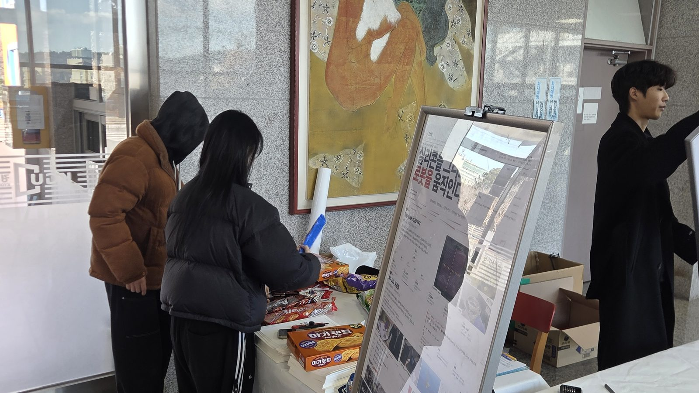

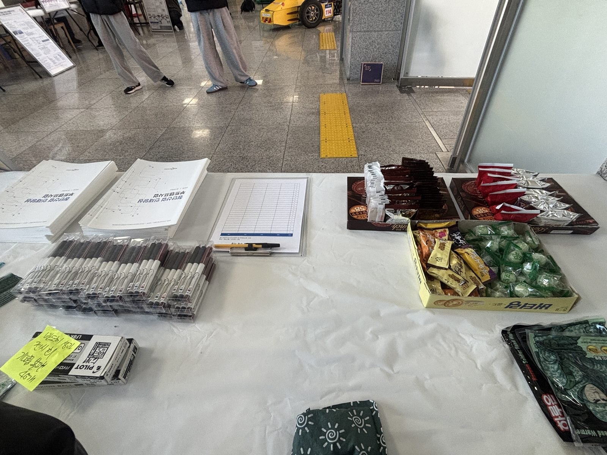

## 점심시간의 로비

점심시간 동안 로비가 관람객으로 붐볐습니다. 부스마다 놓인 QR 코드를 찍어 방문을 인증하며 포스터 사이를 돌아보는 분들도 있었습니다.

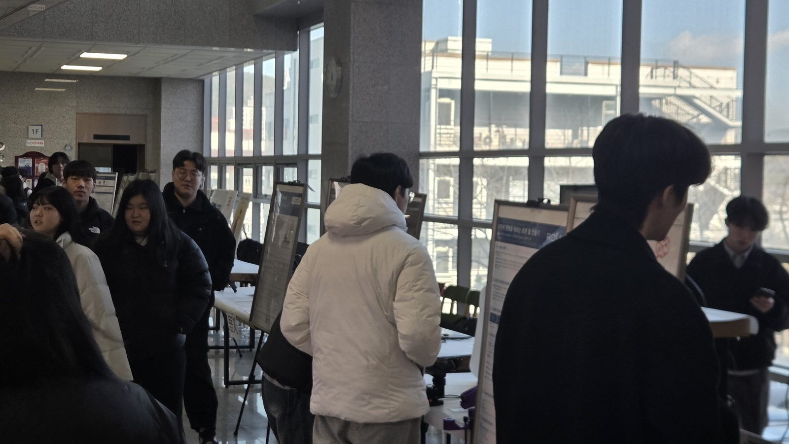

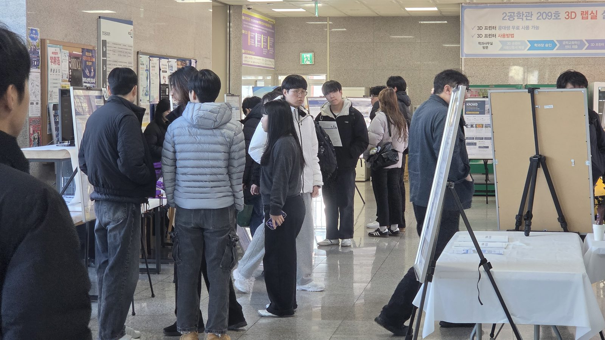

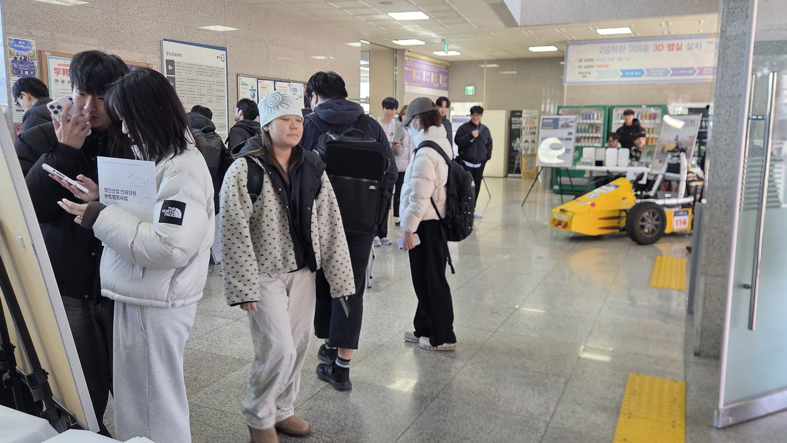

로비에 놓인 KROWD의 자율주행차 앞에도 관람객이 모였습니다.

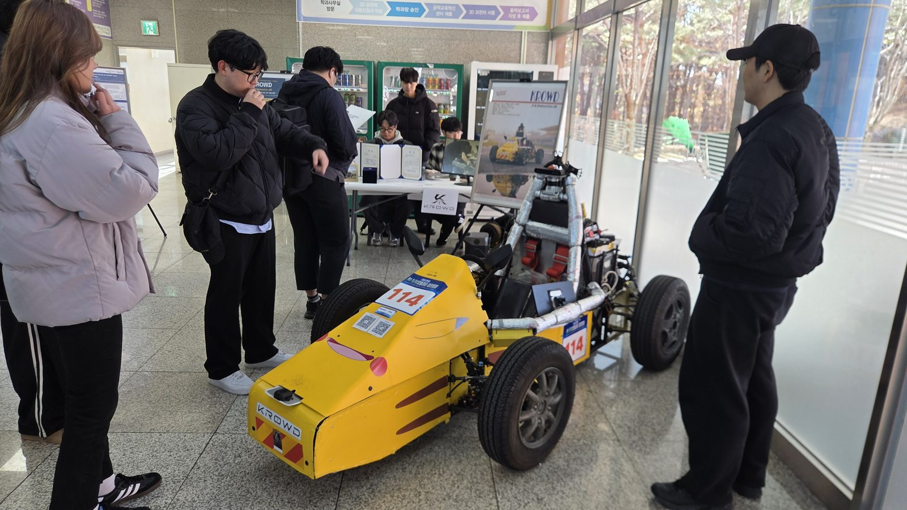

## 부스

포스터는 [온라인 전시]({{ '/news/2026/ee-exhibition-posters/' | relative_url }})에서도 요약과 PDF 원본으로 볼 수 있습니다.

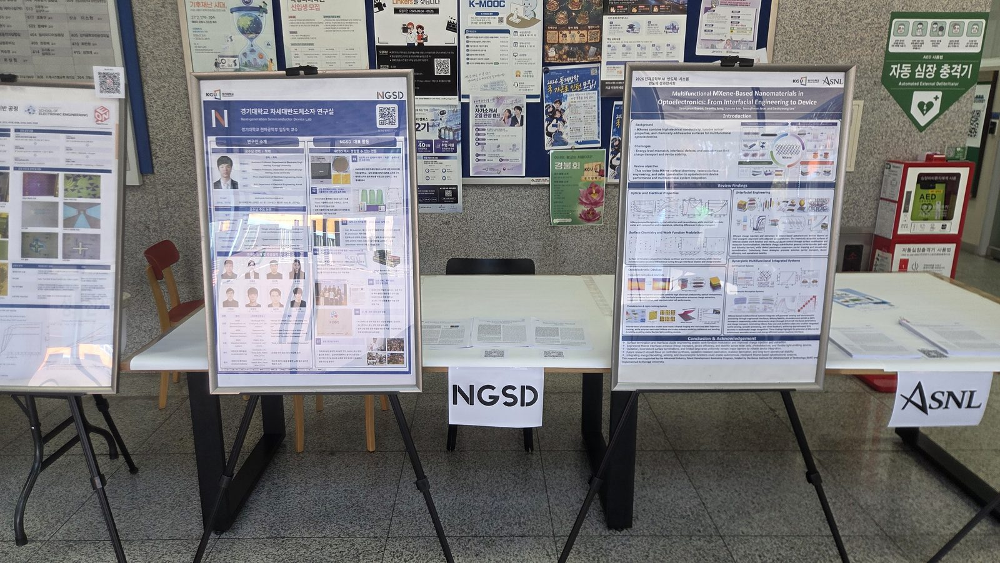

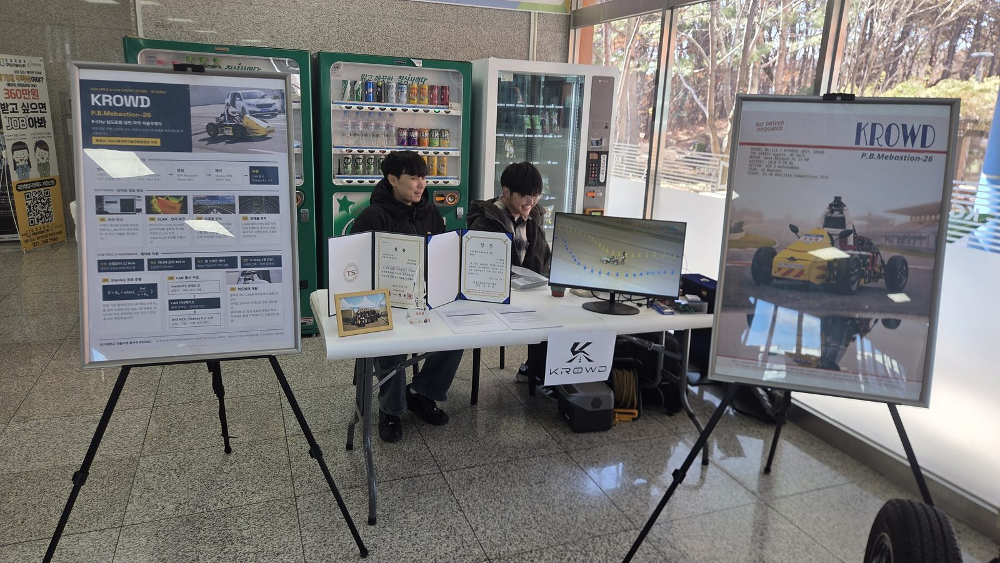

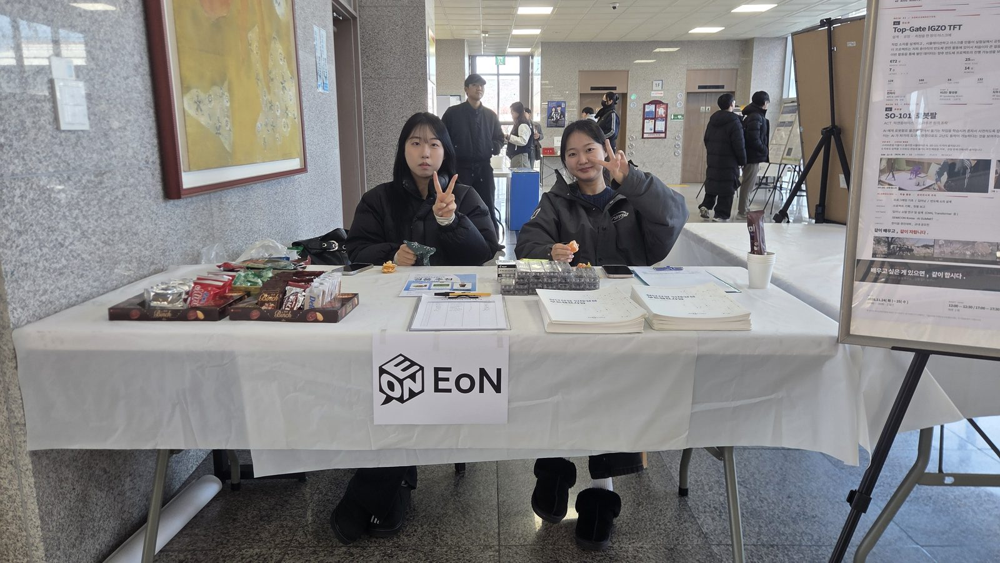

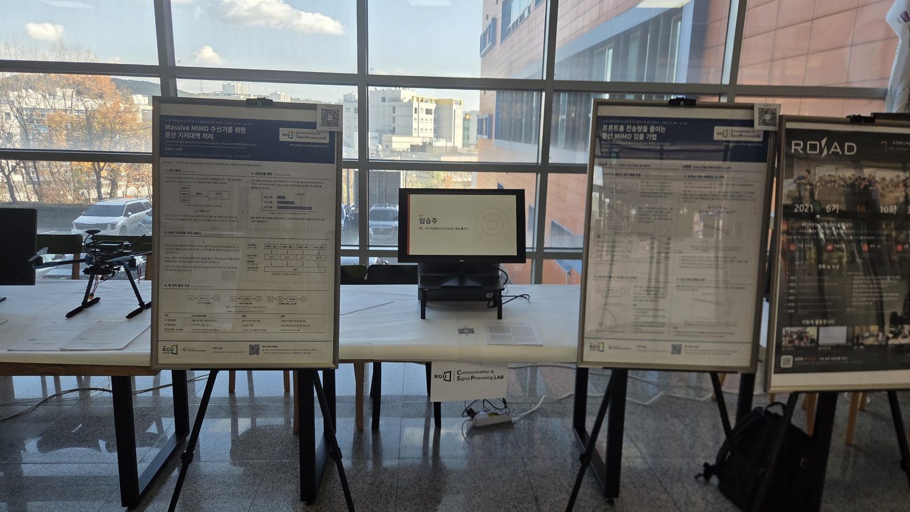

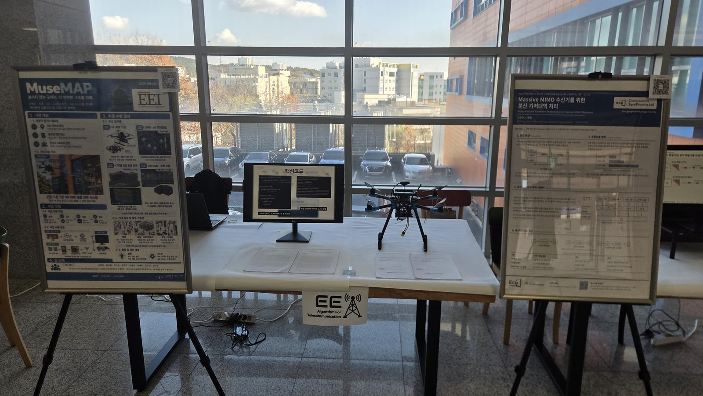

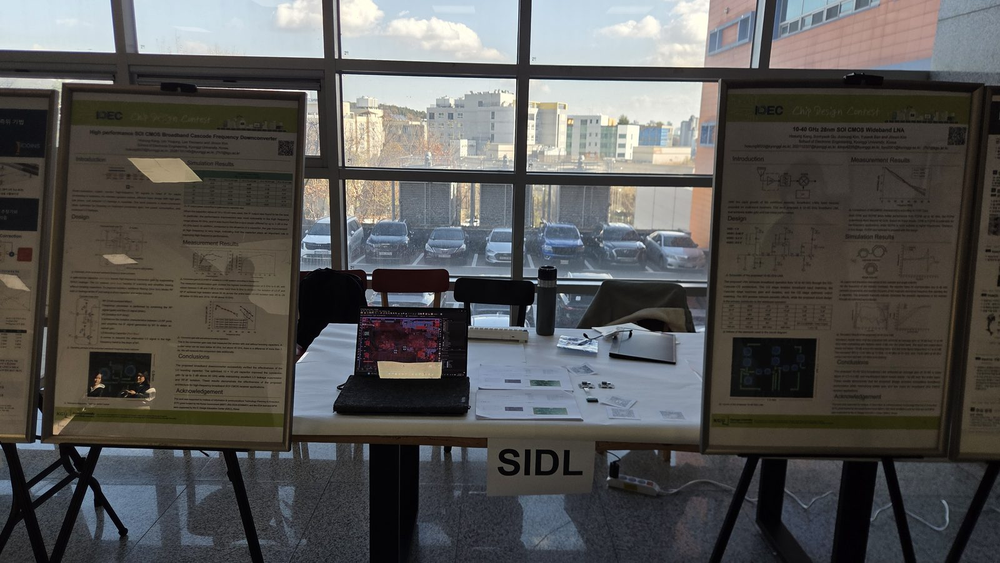

## 1시 이후

점심시간이 지난 뒤에도 포스터를 읽으며 돌아보는 관람객이 있었습니다.

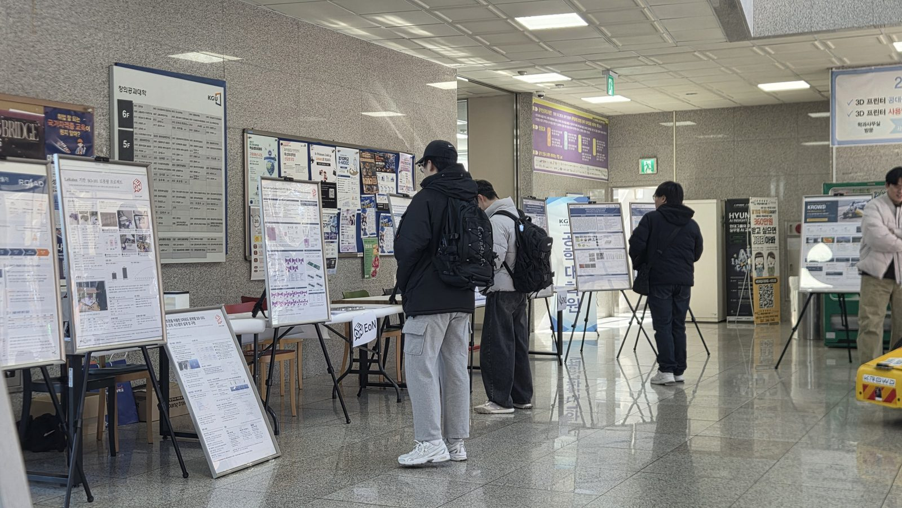

같은 날 낮 시연 시간에는 Unitree Go2와 SO-ARM101이 움직였습니다. [성과전시회 로봇 시연]({{ '/blog/2026/ee-exhibition-robot-demo/' | relative_url }})에 사진과 영상을 따로 모았습니다.

전시는 11월 25일(수) 12:00~18:00에도 같은 자리에서 열립니다.
