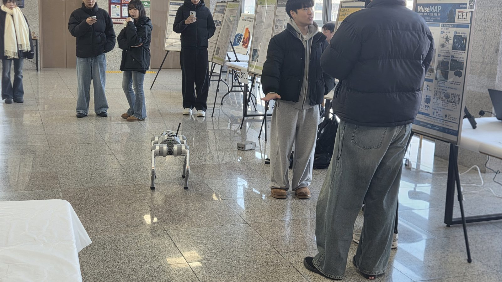
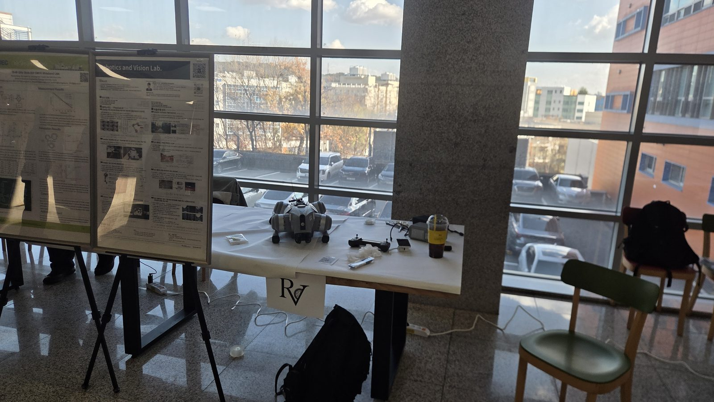
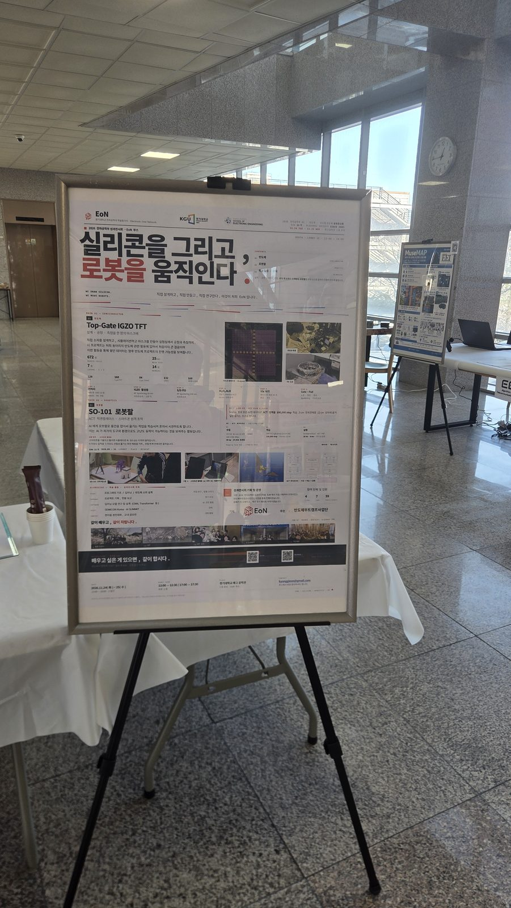

[성과전시회]({{ '/blog/2026/ee-exhibition-day1/' | relative_url }}) 첫날인 11월 24일(화), 낮 시연 시간(12:00~12:30)에 로봇 두 대가 움직였습니다.
시연 일정과 관련 포스터는 [현장 시연 안내]({{ '/news/2026/ee-exhibition-posters/demos/' | relative_url }})에 정리되어 있습니다.

## Unitree Go2

네 발로 걷는 로봇 Unitree Go2가 부스 사이 통로를 걸어 다녔습니다.
관람객 바로 옆을 지나가서, 걸음을 멈추고 휴대폰으로 찍는 분들도 있었습니다.

<video src="/content/images/posts/2026-exhibition-demo-go2.mp4" poster="/content/images/posts/2026-exhibition-demo-go2-poster.jpg" controls muted playsinline preload="metadata" aria-label="Unitree Go2가 로비를 걷는 영상(20초, 소리 없음)"></video>

Go2로 한 자율이동 연구는 RV Lab. 포스터 [길을 찾고, 시약을 붓는 로봇]({{ '/news/2026/ee-exhibition-posters/rvlab-2/' | relative_url }})에 있습니다.

## SO-ARM101

12시 30분쯤에는 로봇 팔 SO-ARM101 시연이 이어졌습니다.
블록과 상자를 올려 둔 책상 위에서 팔을 뻗었다가 제자리로 돌아오는 동작을 보여 드렸습니다.

<video src="/content/images/posts/2026-exhibition-demo-arm.mp4" poster="/content/images/posts/2026-exhibition-demo-arm-poster.jpg" controls muted playsinline preload="metadata" aria-label="SO-ARM101이 움직이는 영상(22초, 소리 없음)"></video>

SO-ARM101로 한 연구는 아래 포스터에서 볼 수 있습니다.

- RO:AD · [자연어 명령을 따르는 로봇 팔]({{ '/news/2026/ee-exhibition-posters/road-1/' | relative_url }})
- EoN · [스마트폰 원격 조작]({{ '/news/2026/ee-exhibition-posters/eon-robot-1/' | relative_url }})
- EoN · [LeRobot 모방 학습]({{ '/news/2026/ee-exhibition-posters/eon-robot-2/' | relative_url }})

시연은 11월 25일(수)에도 12:00~12:30, 17:00~17:30에 같은 자리에서 합니다.
